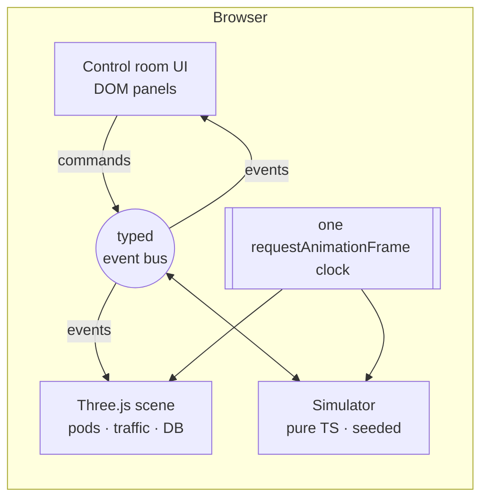

# Incident Simulator

> Break a simulated production platform (kill pods, inject errors or latency, surge traffic, fail over the database) and watch SLOs, alerts, autoscaling and self-healing respond in real time.

**Live:** https://jtmilan.github.io/incident-simulator/
**Status:** in development, v0.1

## What it is

A browser-only, interactive simulation of how a Kubernetes platform behaves under failure. You get a 3D view of a small cluster running a `checkout-api` service in front of a Postgres primary/replica pair. You trigger chaos experiments and watch the platform react: pods reschedule and pass their readiness probes, the HorizontalPodAutoscaler adds replicas, the error budget burns, a burn-rate alert pages, and the database fails over to its replica.

**It is a simulation.** No real cluster runs behind the page. To keep it honest and useful:

- Every panel has a `</> real config` drawer showing the Kubernetes manifests, PromQL and alerting rules that would produce the same behavior on a real cluster.
- Simulated timings follow upstream defaults: the HPA algorithm and stabilization windows, readiness-probe timing, and multi-window burn-rate alerting from the Google SRE Workbook.

No login, no setup. Open the URL and start breaking things.

## What you can do

| Action | What happens |
|---|---|
| Kill a pod | The ReplicaSet replaces it: Pending → ContainerCreating → Ready in about 5–10s |
| Inject 5xx errors | Error rate climbs, the SLO error budget drains, and `HighErrorBudgetBurn` fires |
| Traffic surge | CPU rises and the HPA scales `checkout-api` from 3 up to 10 replicas, then scales down after the 300s stabilization window |
| Inject latency | p95/p99 spike and traffic visibly backs up |
| Fail over the database | Primary health checks fail, writes error while reads continue on the replica, the replica is promoted, the pool reconnects, and the old primary rejoins as a replica |
| Recover all | Chaos stops. The platform heals at realistic speed, and a postmortem card shows time to detect, time to recover and budget burned |

A 90-second guided tour and deep links (`#scenario=pod-kill`, `#scenario=db-failover`, …) jump straight to each scenario.

## Architecture



- **Simulator.** A pure TypeScript module with no DOM access: `step(state, dt, commands) → { state, events }`. It runs like a Kubernetes reconcile loop: compare desired state with actual state and act. Seeded randomness makes every run reproducible and unit-testable.
- **Event bus.** The only contract between the simulator and the screen. A real backend (a Kubernetes watch or the Prometheus HTTP API, streamed over SSE) can replace the simulator later without touching the UI.
- **One clock.** One animation-frame loop drives the simulation and rendering. It pauses when the tab is hidden.

## Stack

| Layer | Choice |
|---|---|
| Build | Vite + TypeScript (no UI framework) |
| 3D | Three.js: `InstancedMesh` for pods and particles, bloom post-processing |
| Motion | GSAP timelines for scripted moments |
| Charts | Lightweight canvas sparklines |
| Tests | Vitest (simulator), Playwright smoke + axe accessibility checks, Lighthouse CI |
| Hosting | GitHub Pages via GitHub Actions |
| Analytics | GoatCounter (cookie-free) |
| Type and icons | Space Grotesk and JetBrains Mono (OFL, self-hosted), Lucide/Tabler icons (ISC/MIT) |

## Simulation model

| Entity | Key fields |
|---|---|
| Cluster | seed, simulation clock, speed |
| Node ×3 | zone a/b/c, capacity, Ready/NotReady |
| Deployment `checkout-api` + HPA | desired replicas; HPA min 3, max 10, target CPU 60% |
| Pod | phase Pending → ContainerCreating → Running → Terminating, ready, CPU, restarts |
| Traffic | ~400 rps baseline with noise; surge, latency and error injection |
| Database | `db-1` primary (zone a), `db-2` replica (zone b), replication lag, connection pool, failover state |
| Metrics | 5-minute history: rps, p50/p95/p99, error %, CPU, replicas, DB lag |
| SLO | 99.9% availability, error budget remaining, short and long window burn rates |
| Alert | `HighErrorBudgetBurn`, `PodNotReady`, `DBPrimaryDown`, each pending → firing → resolved |
| Timeline and Postmortem | every event with its source; time to detect, time to recover, budget burned, peak error rate |

**Modeled behavior**

- **HPA:** syncs every 15s with `desired = ceil(current × currentCPU / targetCPU)` and a 0.1 tolerance. Scale-up stabilization is 0s, scale-down is 300s.
- **Burn rate:** `errorRate / (1 − SLO)`. The page alert uses the multi-window pattern: 14.4× over a long window and a short window.
- **SLO window:** compressed and clearly labeled, so the budget visibly drains during a demo. The real, uncompressed rule is shown in the config drawer.

## Commands and events

| Direction | Contract |
|---|---|
| UI → simulator | `killPod(id?)`, `injectErrors(rate, dur)`, `injectLatency(ms, dur)`, `trafficSurge(mult, dur)`, `failoverDatabase()`, `drainNode(id)`, `recoverAll()`, `setSpeed()`, `reset(seed)` |
| Simulator → UI | `metricsTick`, `podPhaseChanged`, `scaled`, `alertStateChanged`, `dbStateChanged`, `timelineEvent`, `postmortemReady` |

## Delivery

- **Every pull request:** lint, type-check, unit tests with coverage, production build, Playwright smoke test with axe, and a Lighthouse budget.
- **Every merge to `main`:** the same checks, then a deploy to GitHub Pages, then a smoke test against the live URL.
- **Provenance:** the footer shows the commit SHA, linked to that commit, and the CI run that deployed it.
- **Monitoring and supply chain:**
  - A scheduled synthetic check against the live site opens an issue if it fails.
  - Dependabot covers npm and GitHub Actions.
  - Actions are pinned to commit SHAs, and workflow permissions are least-privilege.

## Security

A static site with no accounts, cookies, secrets or user data.

- **Input:** the only input besides buttons is the `#scenario=` hash, which is checked against an allowlist.
- **Content Security Policy:** a strict CSP is set with a `<meta>` tag.
- **Fonts:** self-hosted.
- **Deploys:** Pages deploys use OIDC, so no tokens are stored in the repo.

## Roadmap

| Phase | Name | Outcome |
|---|---|---|
| 1 | Foundation & pipeline | Live placeholder page with CI/CD, provenance footer and monitoring |
| 2 | Simulation engine | All chaos scenarios run headless, tested against real-world timings, with a `?debug` view |
| 3 | 3D scene | The cluster, traffic and database come alive in Three.js, with a visual for each chaos action |
| 4 | Control room + hero | Cinematic intro, ops console, live charts, SLO ring, alerts, timeline, real-config drawers, mobile layout |
| 5 | Tour, polish & launch | Guided tour, deep links, "how this maps to real infra", node drain, performance and accessibility tuning |
| Next | Real backend | Terraform-provisioned k3s, Argo CD + Helm, Prometheus/Grafana/OpenTelemetry feeding the same event bus |

## Design decisions

1. **UI-only simulation first.** Always up, zero ops cost. A real backend comes next.
2. **GitHub Pages from this repo.** The repo and the live app match one-to-one.
3. **No login.** Anyone can open it and use it immediately.
4. **Plain TypeScript + Three.js.** Small bundle, no framework abstraction.
5. **Pure, seeded simulator behind a typed event bus.** Deterministic and testable, and it can be swapped for a real backend.
6. **Upstream defaults for timings,** plus a "real config" drawer on every panel.
7. **SLO window compressed and labeled.** Kubernetes events stay in real time.
8. **"Mission control" visual language.** Near-black navy, one cyan accent, and status colors only on state change.
9. **Open-license assets only.**

## Local development

Coming in Phase 1:

```bash
npm ci
npm run dev       # http://localhost:5173/incident-simulator/
npm test
```

## References

- Kubernetes HPA: https://kubernetes.io/docs/tasks/run-application/horizontal-pod-autoscale/
- Google SRE Workbook, Alerting on SLOs: https://sre.google/workbook/alerting-on-slos/
- CloudNativePG: https://cloudnative-pg.io/documentation/
- GitHub Pages with custom workflows: https://docs.github.com/en/pages/getting-started-with-github-pages/using-custom-workflows-with-github-pages

## License

MIT (added in Phase 1).
